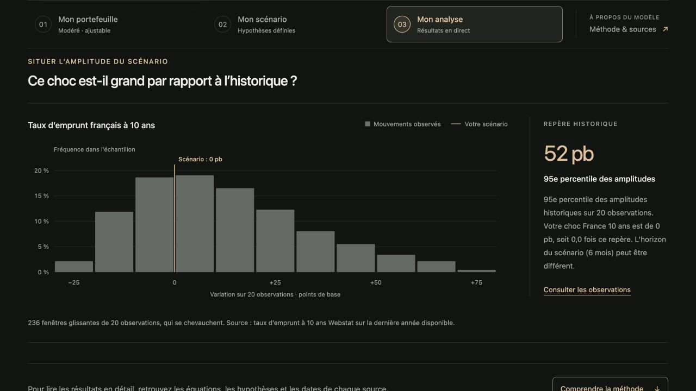

# Portfolio Stress Test

**Un outil interactif en français pour relier des hypothèses économiques à la valorisation d’un portefeuille.**

Par [Omar EL ADLOUNI](https://www.linkedin.com/in/omar-el-adlouni/) · [OLM Bridge](https://olmbridge.com/)



## Ce que propose le simulateur

- **Composer son portefeuille** : allocations Prudent, Modéré, Équilibré et Dynamique, ou composition libre. Saisie des pourcentages, curseurs et rééquilibrage automatique à 100 %.
- **Explorer des scénarios** : tensions sociales en France, propagation européenne, trajectoire budgétaire, énergie, taux communs, crédit et change. « Point de départ · Aucun choc » est sélectionné par défaut.
- **Mesurer les effets** : résultat en euros, rendement, contributions par actif, courbe des taux, transmission aux souverains et variations conditionnelles des marchés.
- **Comparer** le choc à l’historique observé, conserver une référence, partager un scénario et exporter l’analyse au format CSV.
- **Comprendre le modèle** : équations, coefficients, conventions et provenance des observations sont accessibles dans une section distincte.

Les cours du bandeau TradingView restent un affichage du fournisseur, distinct du calcul des scénarios. Les données nécessaires au modèle sont récupérées par les fonctions serveur Webstat et BCE, avec DBnomics en secours pour les séries BCE.

## Démarrage local

### Prérequis

- Node.js **22 ou ultérieur**, avec npm.
- Une clé API Webstat personnelle pour les taux français et EUR/USD. Les séries de contexte BCE ne nécessitent pas de clé.

```bash
git clone https://github.com/OmarELADLOUNI/simulateur-chocs-portefeuille.git
cd simulateur-chocs-portefeuille
cp .env.example .env
```

Ouvrir `.env` avec un éditeur et renseigner sa propre clé après `WEBSTAT_API_KEY=`. Ce fichier est ignoré par Git.

```bash
npm run dev
```

Ouvrir **http://localhost:8888/**. Au premier lancement, `npx` peut proposer d’installer l’outil officiel `netlify-cli`. Le serveur local exécute les fonctions et lit la configuration locale. Une connexion à un compte Netlify n’est pas nécessaire pour ce projet autonome avec `.env`.

Sans clé Webstat, les indicateurs BCE et les hypothèses restent explorables ; les valorisations qui nécessitent des données françaises sont signalées comme indisponibles. Aucun cours de remplacement n’est inventé.

**Un simple double-clic sur `index.html` ne lance pas les fonctions serveur.** Un serveur statique seul ne suffit pas à actualiser les données.

### Construire les fichiers du site

```bash
npm run build
```

Le résultat se trouve dans `dist/`. La construction utilise uniquement Node.js, sans dépendance à installer. Elle copie une liste explicite de fichiers publics ; les fonctions, la configuration locale, la documentation et les secrets ne sont pas copiés dans ce dossier.

## Hébergement sur Netlify

GitHub conserve le code et son historique. Netlify exécute le site et ses fonctions serveur. GitHub Pages n’est pas nécessaire.

Pour une **nouvelle installation** sur son propre compte Netlify :

1. Importer ce dépôt dans un nouveau projet Netlify.
2. Conserver les paramètres de `netlify.toml` : commande `npm run build`, dossier public `dist`, fonctions `netlify/functions`.
3. Ajouter `WEBSTAT_API_KEY` dans les variables d’environnement du projet, pour le périmètre **Functions** et le contexte de déploiement utilisé.
4. Déployer le projet. Chaque utilisateur de cette installation utilise les fonctions de son propre projet Netlify ; la clé n’est jamais envoyée au navigateur.

Pour créer un aperçu depuis un dossier déjà lié à **son** projet Netlify :

```bash
npx netlify-cli login
npx netlify-cli link
npm run preview
```

Cette commande crée un déploiement de prévisualisation, sans `--prod`. Si le dépôt est ensuite relié au déploiement continu, les changements de la branche de production peuvent être publiés automatiquement : configurer ce fonctionnement avant d’y envoyer des modifications. Ce dépôt ne contient aucun workflow GitHub Actions de déploiement.

Les dossiers `.netlify/`, `dist/`, les dépendances et les fichiers `.env` locaux ne sont pas versionnés. Un glisser-déposer de `dist/` seul ne suffit pas à publier les fonctions.

## Organisation des fichiers

```text
index.html                 Interface du simulateur
assets/
  simulator.js             État de l’interface et orchestration des données
  engine.js                Moteur de transmission et revalorisation
  charts.js                Graphiques SVG interactifs
  context.js               Indicateurs BCE et historiques
  indices.js               Bandeau officiel TradingView
  interactions.js          Aides, animations et chargements
  simulator.css            Charte générale
  journey.css              Parcours, méthodologie et affichage mobile
config/                    Paramètres SEO et suivi optionnel du simulateur
lib/simulator-build.mjs    Métadonnées et pages techniques du simulateur
content/
  scenarios.js             Scénarios, actifs, paramètres et plages de saisie
  portfolios.js            Allocations types et leurs références
  indices.js               Symboles du bandeau TradingView
netlify/
  functions/webstat.mjs     Accès Webstat avec clé côté serveur
  functions/ecb.mjs         Accès BCE direct, secours DBnomics
  functions/dbnomics.mjs    Compatibilité avec l’ancienne route
  lib/market-series.mjs     Catalogue des séries de contexte autorisées
scripts/build.mjs          Construction du simulateur autonome
scripts/integrate-site.mjs Intégration au site personnel
.env.example               Configuration vierge à copier en local
```

Ce dépôt est réservé à **Portfolio Stress Test**. Il ne contient pas les sources des autres pages du site personnel. Les liens de navigation vers le site de l’auteur restent de simples liens externes. Pour installer le simulateur dans un site existant, voir la [procédure d’intégration](docs/INTEGRATION.md).

Le registre des observations et leurs liens sources sont intégrés directement à la section « Méthode & sources ». L’ancien explorateur Webstat séparé a été retiré.

## Modifier le contenu

| Besoin | Fichier |
|---|---|
| Ajouter un scénario, ajuster son texte ou ses hypothèses | `content/scenarios.js` |
| Modifier une allocation type | `content/portfolios.js` |
| Choisir les instruments du bandeau | `content/indices.js` |
| Modifier la présentation et les textes de la page | `index.html`, `assets/journey.css`, `assets/simulator.css` |
| Comprendre ou faire évoluer les calculs | `assets/engine.js`, [Méthodologie](docs/MODELE.md) |
| Comprendre les séries et les dates | [Données et API](docs/DONNEES.md) |

Les libellés et scénarios sont regroupés dans de petits fichiers JavaScript lisibles. Les valeurs des marchés et les dates d’observation sont récupérées dynamiquement, sans cotations figées dans le code.

## Conventions de lecture

- Les scénarios expriment des **hypothèses conditionnelles** ; ils n’attribuent aucune probabilité à une élection ou à une manifestation.
- Les obligations sont synthétiques, initialement au pair, et revalorisées par actualisation de leurs flux. Leur rendement de marché n’est pas la performance totale d’un indice obligataire.
- Le modèle isole la revalorisation : sans portage, coupons encaissés, dividendes, frais, fiscalité ni coût de couverture.
- Les fenêtres historiques se chevauchent ; leurs fréquences ne sont pas des probabilités futures.
- Les allocations types ne reproduisent pas les positions d’un fonds commercialisé. Aucun SRI réglementaire ne leur est attribué.

Le détail des mécanismes, y compris les sensibilités modifiables et les limites du modèle, figure dans [docs/MODELE.md](docs/MODELE.md).

## Contribuer et contacter l’auteur

Les propositions d’amélioration peuvent être présentées dans une issue ou une pull request. Pour une évolution du calcul, préciser l’hypothèse économique, les unités et l’effet attendu sur les résultats. Ne pas joindre de clé API ou de données confidentielles.

Contact : [Omar EL ADLOUNI sur LinkedIn](https://www.linkedin.com/in/omar-el-adlouni/).

## Licence et sources externes

Le code est publié sous la [licence MIT](LICENSE), déjà choisie lors de la création du dépôt. La licence MIT permet d’utiliser, modifier et redistribuer le code, y compris commercialement, en conservant la notice de copyright et la licence dans les copies ou parties substantielles. Le logiciel est fourni sans garantie. Les données, marques et composants externes restent soumis aux conditions de leurs fournisseurs. L’attribution TradingView est conservée et le flux n’est pas extrait pour alimenter le modèle.

Le logo GitHub provient de [Primer Octicons](https://github.com/primer/octicons/blob/main/icons/mark-github-16.svg). Sa [licence MIT](assets/github-mark.LICENSE) est incluse.

## Référencement et statistiques

La construction génère les métadonnées du simulateur, sa carte de partage, un sitemap, une page de confidentialité et une page 404. Le suivi Umami est optionnel et désactivé par défaut, sans identifiant personnel dans ce dépôt. Les previews restent non indexables et sans collecte. Voir [SEO et statistiques](docs/SEO-STATISTIQUES.md).

## Protection des accès aux données

Les fonctions refusent les séries et périodes non autorisées, les paramètres répétés et les requêtes trop longues. Elles ne constituent pas un proxy vers une URL fournie par le visiteur. Les réponses sont non indexables et utilisent `nosniff`. Les réponses fournisseur brutes et la clé Webstat ne sont jamais renvoyées au navigateur.

Une règle Netlify de 60 requêtes par minute, par IP et domaine, protège la passerelle `/api/market-data/:provider`, commune aux deux fournisseurs. Son chemin est explicite ; les anciens points d’entrée natifs ne sont plus déployés. DBnomics reste un relais serveur de la BCE. Le cache reste actif pour limiter les appels aux fournisseurs. Cette limite ne constitue pas un plafond financier global.

Vérification locale sans vraie clé ni appel réseau : `node --test tests/proxies-security.test.mjs`.
